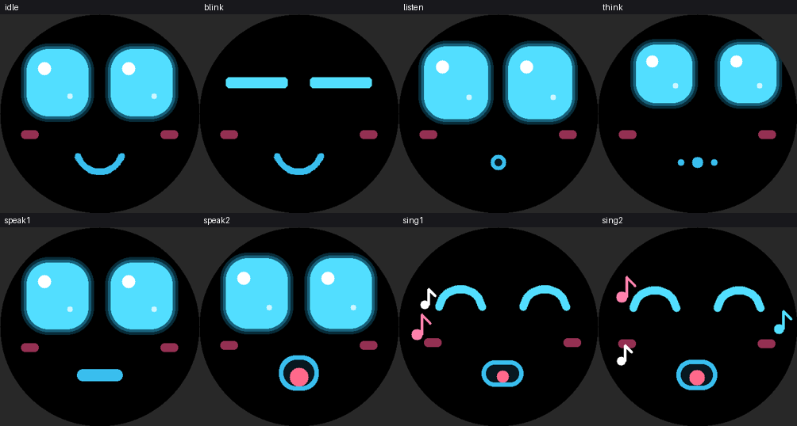
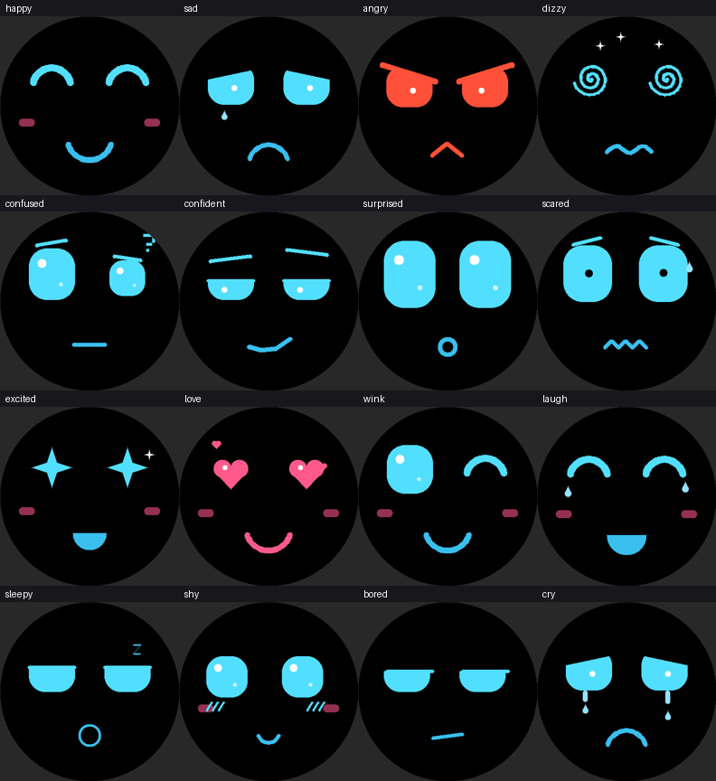

# Robit Mark 1

Robot de escritorio parlante con una **cara animada en una pantalla redonda**. Lo llamas con **"hey buddy"**, conversa contigo en español o inglés, muestra emociones, abre su menú cuando se lo pides, busca en internet, te muestra mapas, te dice la hora y el clima, toca canciones y reproduce videos (con sonido) desde una tarjeta microSD.

> **Estado del proyecto (octubre 2026):** hoy es una **cabeza parlante**. Todavía **no tiene servos (no camina ni mueve brazos) ni cámara**; los planos del cuerpo están en `hardware/` para cuando se construya. El firmware funciona sin ellos: el robot no habla de piernas ni brazos mientras no los tenga.

<p align="center"></p>

---

## Índice
1. [Qué hace](#1-qué-hace)
2. [Cómo funciona y qué tan rápido responde](#2-cómo-funciona-y-qué-tan-rápido-responde)
3. [Materiales](#3-materiales)
4. [Paso 1: cuentas y claves](#4-paso-1-cuentas-y-claves)
5. [Paso 2: preparar Arduino IDE](#5-paso-2-preparar-arduino-ide)
6. [Paso 3: tus claves en secrets.h](#6-paso-3-tus-claves-en-secretsh)
7. [Paso 4: subir el firmware](#7-paso-4-subir-el-firmware)
8. [Paso 5: tarjeta microSD](#8-paso-5-tarjeta-microsd-canciones-y-videos-con-sonido)
9. [Paso 6: usar a Robit](#9-paso-6-usar-a-robit)
10. [Las caras](#10-las-caras)
11. [Ajustes del firmware](#11-ajustes-del-firmware)
12. [Solución de problemas](#12-solución-de-problemas)
13. [Seguridad de las claves](#13-seguridad-de-las-claves)
14. [Lo que falta: servos y cámara](#14-lo-que-falta-servos-y-cámara)
15. [Estructura del repositorio](#15-estructura-del-repositorio)
16. [Qué está probado y qué no](#16-qué-está-probado-y-qué-no)
17. [Créditos y licencia](#17-créditos-y-licencia)

---

## 1. Qué hace

- **Conversa por voz** en español chileno o inglés (sigue el idioma en que le hablas).
- **Palabra de activación "hey buddy"**: en modo automático solo responde si oye la frase (también entiende variantes como "hey body" o "ey badi"). Después sigue conversando **12 segundos** sin que la repitas.
- **Cara con emociones**: ojos grandes y redondeados con brillo, mejillas y boca con volumen que se abre con la voz. 17 expresiones, elegidas por Claude según lo que dice. **Canta** (cierra los ojos, se balancea y salen notas) cuando suena una canción.
- **Menú por voz**: "abre el menú", "abre las canciones", "abre los videos", "cierra el menú"...
- **Búsqueda en internet** (noticias, resultados, precios, datos recientes).
- **Mapas de Google** en la pantalla redonda (con zoom y arrastre), rutas y lugares cercanos. Necesita una clave de Google (opcional).
- **Hora, fecha y clima** de donde está y de cualquier ciudad del mundo.
- **Canciones MP3** desde la microSD (carpeta `music`).
- **Videos con sonido** desde la microSD (carpeta `video`): clips cortos o **películas completas**. Se detienen tocando la pantalla o con el botón BOOT.
- **Temporizadores y alarmas**, **memoria** que se conserva al reiniciar, y reacciones al tocarlo, sacudirlo o levantarlo.

## 2. Cómo funciona y qué tan rápido responde

```
 tú ──voz──> micrófono ──> OpenAI gpt-4o-mini-transcribe (voz a texto)
                                   │
                          ¿dijiste "hey buddy"?
                                   │ sí
                                   ▼
              Claude Haiku 4.5 (cerebro, respuesta en streaming)
                                   │  empieza a hablar con la primera frase
                                   ▼
 parlante <── OpenAI tts-1 (texto a voz, en streaming) ──┘
```

Todo corre en la propia placa por Wi-Fi: **no necesita computador**.

**Meta: que responda entre 1 y 3 segundos después de que terminas de hablar.** Lo que se hizo para lograrlo:

- Las herramientas lentas (búsqueda web, mapas, clima de otras ciudades) **solo se envían a Claude cuando tu frase las necesita**. Una conversación normal va por el camino rápido, sin herramientas.
- Respuestas cortas (una frase), prompt corto, pocos mensajes de historial.
- Voz `tts-1` en streaming y a velocidad 1.15; empieza a sonar con la primera frase, sin esperar la respuesta completa.
- Corta tu frase tras solo 0.45 s de silencio.
- Las conexiones seguras se abren mientras todavía estás hablando.

**Cómo medirlo:** abre el Monitor Serie (115200). Después de cada respuesta imprime una línea:

```
ANSWER TIME: from when you stopped talking to his first sound: 2.1 s
```

Eso es lo que sentirás. Si pasa de 3 s:
1. Mira la señal del Wi-Fi (un hotspot de celular cercano responde más rápido que un Wi-Fi con mala señal).
2. Sube `VAD_END_SILENCE` si te corta, o bájalo (mínimo ~0.35) si tarda en reaccionar.
3. Las preguntas que usan búsqueda web o mapas son **más lentas** por naturaleza (varios segundos): no entran en la meta de 1-3 s.

## 3. Materiales

| Pieza | Detalle |
|---|---|
| Placa | **Waveshare ESP32-S3-Touch-LCD-1.85** (la original, con chip de audio PCM5101). Trae pantalla redonda 360×360, micrófono, parlante, táctil, sensor de movimiento y ranura microSD. |
| Tarjeta | microSD de **32 GB o menos, FAT32** |
| Batería (opcional) | LiPo para la placa |
| Servos y cámara | **No incluidos todavía** (ver sección 14) |

> Las versiones "1.85B" y "1.85C" de la placa usan otros chips de audio y otros pines: este firmware es para la original.

## 4. Paso 1: cuentas y claves

1. **OpenAI** (voz a texto y texto a voz): https://platform.openai.com/api-keys
2. **Anthropic** (el cerebro, Claude): https://console.anthropic.com/settings/keys
3. **Google Maps** (opcional, solo para mapas): activa *Maps Static API*, *Routes API* y *Places API (New)* en https://console.cloud.google.com y crea una clave de API.

En OpenAI y Anthropic **pon un límite de gasto mensual**.

## 5. Paso 2: preparar Arduino IDE

1. Instala **Arduino IDE 2.x**.
2. En *Archivo > Preferencias > Gestor de URLs adicionales* agrega `https://espressif.github.io/arduino-esp32/package_esp32_index.json`.
3. En *Gestor de tarjetas* instala **esp32 by Espressif Systems**, versión **3.0.2 o superior**.
4. En *Herramientas* elige exactamente:

| Opción | Valor |
|---|---|
| Placa | **ESP32S3 Dev Module** |
| Flash Size | **16MB** |
| PSRAM | **OPI PSRAM** (obligatorio) |
| Partition Scheme | **16M Flash (3MB APP/9.9MB FATFS)** |
| USB CDC On Boot | **Enabled** |

5. En *Gestionar bibliotecas* instala:

| Biblioteca | Autor | Para qué |
|---|---|---|
| **GFX Library for Arduino** | moononournation | pantalla redonda |
| **ArduinoJson** (versión 7) | Benoit Blanchon | comunicación con las APIs |
| **WebSockets** | Markus Sattler | conexión interna |
| **JPEGDEC** | Larry Bank | mapas, fotos y **videos** |
| **libhelix** | Phil Schatzmann | canciones MP3. Si no aparece en la lista: descarga el ZIP de https://github.com/pschatzmann/arduino-libhelix y usa *Sketch > Incluir biblioteca > Añadir biblioteca .ZIP* |

Sin libhelix las canciones y los videos se apagan solos y el resto sigue funcionando.

## 6. Paso 3: tus claves en secrets.h

Las claves **no van dentro del `.ino`** (así no se filtran al subir el código a GitHub). Van en un archivo aparte que Git ignora:

1. En la carpeta `Robit_Mark_1/`, copia `secrets.example.h` y renombra la copia a **`secrets.h`**.
2. Ábrelo y completa:

```cpp
#define WIFI_SSID   "NOMBRE_DE_TU_WIFI"            // solo 2.4 GHz
#define WIFI_PASS   "CLAVE_DE_TU_WIFI"
#define WIFI_SSID2  "TU_HOTSPOT_DEL_CELULAR"       // red de respaldo (opcional)
#define WIFI_PASS2  "CLAVE_DEL_HOTSPOT"
#define OPENAI_KEY     "sk-..."
#define ANTHROPIC_KEY  "sk-ant-..."
#define GOOGLE_MAPS_KEY ""                          // opcional: solo para mapas
```

3. Abre `Robit_Mark_1.ino` en Arduino IDE: `secrets.h` aparece como una pestaña a su lado.

Si no existe `secrets.h`, el firmware compila con marcadores y al arrancar avisa por el Monitor Serie que faltan las claves.

Dentro del `.ino`, en `YOUR SETTINGS`, también puedes cambiar `CITY_NAME`, `CITY_LAT` y `CITY_LON` (para el clima de donde vive) y `ROBOT_FACTS` (datos verdaderos sobre él que puede contar).

**Wi-Fi:** la placa solo usa 2.4 GHz y no puede entrar a redes con página de login (hoteles, ferias, colegios). Lo más seguro es un **hotspot de celular** (iPhone: "Maximizar compatibilidad") como `WIFI_SSID2`. Sin tocar el código, se puede cambiar de red desde el menú: *Settings > Wi-Fi* abre la red `Robit-Setup`; conecta el celular, abre `192.168.4.1`, elige la red y guarda.

## 7. Paso 4: subir el firmware

1. Conecta la placa por USB-C y elige el puerto en *Herramientas > Puerto*.
2. Pulsa **Subir**. Si falla: mantén apretado **BOOT**, conecta el USB, suelta BOOT y vuelve a subir.
3. Abre el **Monitor Serie a 115200**. Al arrancar deberías ver, entre otras cosas:
   - la conexión Wi-Fi,
   - `SD card: ... -> mounted`, `SD read test ... OK`, `SD card: N songs in /music` y `SD card: N videos in /video`,
   - `servo driver (PCA9685) NOT found ... movements disabled`: **es normal**, todavía no tiene servos.
4. Di **"hey buddy, hola"**.

Comandos del Monitor Serie (con "Newline"): `faces` (muestra todas las expresiones, 3 s cada una), `face happy` (una), `face idle` (vuelve a la normal).

## 8. Paso 5: tarjeta microSD (canciones y videos con sonido)

Formatea la tarjeta en **FAT32** y crea dos carpetas en la raíz: `music` y `video`. Apaga el robot antes de insertarla. En `sd_card/` de este repositorio hay un video de muestra (`Robit_demo.avi`, 30 s con sonido): cópialo a la carpeta `video`.

### Canciones
MP3 a 128 kbps, nombres cortos sin tildes ni símbolos (`01_cumbia.mp3`), máximo 60:
```bash
ffmpeg -i entrada.mp3 -b:a 128k -ar 44100 -ac 2 01_cumbia.mp3
```

### Videos y películas (con sonido)
Formato exacto: **AVI, video Motion-JPEG 360×360 a 24 cuadros por segundo, sonido PCM 16 bits**. La forma fácil es el script de `tools/`:

- Mac/Linux: `./tools/convertir_video.sh pelicula.mp4`
- Windows: arrastra el video sobre `tools\convertir_video.bat`

O el comando directo (necesitas [ffmpeg](https://ffmpeg.org)):
```bash
ffmpeg -i pelicula.mp4 \
  -vf "scale=360:360:force_original_aspect_ratio=decrease,pad=360:360:(ow-iw)/2:(oh-ih)/2,fps=24" \
  -c:v mjpeg -q:v 8 -c:a pcm_s16le -ar 24000 -ac 1 pelicula.avi
```

- La pantalla es redonda: el video se centra con bandas negras. Si prefieres llenarla, recorta el video a cuadrado antes (por ejemplo `crop=min(iw\,ih):min(iw\,ih)` antes de `scale`).
- **Tamaño aproximado:** con calidad `-q:v 8`, ~130 KB/s de video + 48 KB/s de sonido, o sea ~0.6 GB por hora. Para una **película de 2 horas** usa `-q:v 10` a `12` y ocupará ~1.1-1.3 GB. FAT32 admite archivos de hasta 4 GB.
- Los archivos de **más de 1 GB** (formato OpenDML/AVIX) están soportados.
- Máximo 40 videos, con nombres cortos sin tildes (`peli_01.avi`).
- Si el chip no alcanza a decodificar a 24 cuadros por segundo, **salta cuadros pero el sonido nunca se corta** y la imagen sigue al sonido.
- El video **se repite** al terminar. Se detiene tocando la pantalla, con el botón **BOOT**, o diciendo "para" / "stop".
- Si el video se ve a saltos, usa un `-q:v` más alto (12 a 15): pesa menos y decodifica más rápido.

## 9. Paso 6: usar a Robit

### Hablarle
- Di **"hey buddy"** y habla: *"hey buddy, ¿qué hora es?"*. También puedes decirlo solo y esperar su saludo.
- Después de cada respuesta tienes **12 segundos** para seguir sin repetir la frase (`WAKE_FOLLOWUP_MS`).
- Para interrumpirlo: botón **BOOT**, o di "para", "stop", "alto", "basta" o "silencio".
- El botón **BOOT** también sirve para hablarle sin decir la frase (útil con música o video, que mientras suenan le tapan el oído).

### Menú por voz
| Dices | Hace |
|---|---|
| "abre el menú" / "open the menu" | menú principal |
| "abre las canciones" | lista de canciones |
| "abre los videos" | lista de videos |
| "abre las caras" | menú de expresiones |
| "abre el idioma" | menú de idioma |
| "abre los ajustes" | ajustes |
| "abre el mapa" | mapa de Google |
| "cierra el menú" | cierra el menú |

### Otras cosas que puedes pedir
- "Ponme una canción", "pon [nombre]", "pausa", "siguiente".
- "Muéstrame un video", "muéstrame [nombre]".
- "Muéstrame el mapa de...", "cómo llego a...", "cafés cerca de aquí".
- "¿Qué hora es en Tokio?", "¿qué clima hay en París?".
- "Busca las últimas noticias de...", "¿quién ganó el partido de...?".
- "Pon un temporizador de 5 minutos", "despiértame a las 7:30".
- "Sube / baja el volumen", "habla más rápido / más lento".
- "Duérmete", "buenas noches", "quédate despierto".
- "Tu nombre es ..." (cambia su nombre). "Recuerda que..." (lo guarda aunque se apague).

### Menú táctil
Doble toque en la cara, mantener el dedo 1 s, o deslizar hacia abajo. Botones: Faces, Map, Weather, Hour, Language, Songs, Videos, Settings (Wi-Fi, volumen, modo de escucha, batería, dormir y más).

## 10. Las caras

Robit elige la expresión según lo que dice (Claude la marca con una etiqueta que no se pronuncia) y según lo que le pasa: sacudirlo lo marea, levantarlo lo sorprende, tocarlo le saca una reacción, y al sonar una canción **canta**.

<p align="center"></p>

Estas imágenes salen de un simulador de la pantalla hecho con el mismo código de dibujo del firmware.

## 11. Ajustes del firmware

Arriba del `.ino`:

| Ajuste | Qué hace |
|---|---|
| `WAKE_HEYBUDDY` | 1 = solo responde tras "hey buddy". 0 = responde a todo |
| `WAKE_FOLLOWUP_MS` | Cuánto sigue escuchando sin la frase después de responder (12000) |
| `LISTEN_AUTO` | 1 = escucha siempre. 0 = solo con el botón BOOT |
| `VAD_MIN_RMS` | Sube el valor si hay ruido y se activa solo; bájalo si no te oye |
| `VAD_END_SILENCE` | Silencio (s) para dar por terminada tu frase. Más bajo = responde antes |
| `CLAUDE_MODEL` | `claude-haiku-4-5-20251001` (rápido). Más inteligente y más lento: `claude-sonnet-5-5` |
| `TTS_MODEL` / `TTS_SPEED` | `tts-1` (el más rápido) y su velocidad (1.15) |
| `SPK_VOLUME` | Volumen del parlante (0.0-1.0) |
| `USE_MAP` | 1 = mapas (necesita `GOOGLE_MAPS_KEY`) |
| `USE_SD_MUSIC` / `USE_VIDEO` | Canciones y videos de la SD |
| `SLEEP_AFTER_SEC` | Segundos de silencio antes de dormirse (0 = nunca) |
| `TOUCH_FLIP_X`, `TOUCH_FLIP_Y`, `TOUCH_SWAP_XY` | Si el táctil responde espejado o girado |

## 12. Solución de problemas

**No responde a "hey buddy".** Mira el Monitor Serie: `(heard, not for me: ...)` significa que oyó algo pero no la frase; repítela claro y cerca. Si no aparece nada, baja `VAD_MIN_RMS`. En una sala ruidosa usa el botón BOOT.

**Se queda en silencio o se corta.** Revisa que el Wi-Fi sea 2.4 GHz, que las claves estén bien escritas en `secrets.h` y que las cuentas tengan crédito.

**Tarda más de 3 segundos.** Revisa la línea `ANSWER TIME` (sección 2). Las preguntas con búsqueda o mapa son más lentas por naturaleza.

**La SD no lee (`SD read test ... FAILED`).** El firmware prueba solo los dos modos de la tarjeta (SD_MMC y SPI) y se queda con el primero que lee. Si fallan todos: tarjeta FAT32 de 32 GB o menos, apaga y vuelve a insertar, prueba otra tarjeta, y copia las líneas `SD card:` del Monitor Serie para diagnosticar.

**El video no abre.** Debe ser AVI con video Motion-JPEG. El Monitor Serie dice `video: cannot read ...`. Reconviértelo con `tools/convertir_video.sh`. Si el sonido no es PCM de 16 bits, el video se reproduce sin sonido (lo avisa en el Monitor Serie).

**El video va a saltos o el sonido se adelanta.** Usa `-q:v` más alto (12-15). El sonido manda: la imagen salta cuadros para seguirlo.

**`touch NOT found`.** Desconecta el cable I2C externo y reinicia; el conector compartido puede interferir con el táctil.

**El nivel de batería es incorrecto.** `BAT_ADC_PIN` (8) y `BAT_DIVIDER` (3.0) son supuestos. Compara con un multímetro y ajusta `BAT_CAL`.

## 13. Seguridad de las claves

- Las claves viven en **`secrets.h`**, que está en `.gitignore`: nunca se sube. **No lo copies ni lo pegues en chats, correos ni issues.**
- Si una clave alguna vez se mostró en un chat, un correo o un repositorio, trátala como expuesta: **revócala y crea una nueva** en OpenAI, Anthropic y Google.
- Cambia la clave del hotspot si estuvo escrita en algún archivo compartido.
- Pon límites de gasto en OpenAI y Anthropic, y restringe la clave de Google a las 3 APIs de mapas.

## 14. Lo que falta: servos y cámara

El firmware ya trae el código para **6 servos** (PCA9685: caderas, tobillos y brazos) y una **cámara** externa (`USE_CAMERA`, módulo en `hardware/camera/`), pero **hoy no están conectados**:

- Sin servos el robot lo detecta al arrancar (`servo driver ... NOT found`) y desactiva los movimientos. Claude deja de mencionar piernas y brazos.
- La cámara está apagada (`USE_CAMERA 0`).
- Los planos 3D del cuerpo (`hardware/3d`), los planos 2D y las plantillas de cartón están listos. Cuando se conecten los servos, el firmware los usa solo.

Cableado previsto de los servos (conector I2C de la placa, **GPIO11 = SDA, GPIO10 = SCL**): PCA9685 GND/VCC/SDA/SCL al conector I2C, V+ del borne verde a una **fuente separada de 5-6 V y mínimo 5 A** con GND común. **Nunca alimentes servos desde la placa ni desde la LiPo.** Canales: 0 = cadera izquierda, 1 = cadera derecha, 2 = tobillo izquierdo, 3 = tobillo derecho, 4 = brazo izquierdo, 5 = brazo derecho.

## 15. Estructura del repositorio

```
├── README.md
├── Robit_Mark_1/
│   ├── Robit_Mark_1.ino        # el firmware
│   └── secrets.example.h       # copia a secrets.h y pon tus claves (secrets.h no se sube)
├── sd_card/
│   ├── video/Robit_demo.avi    # video de muestra con sonido
│   └── music/LEEME.txt
├── tools/                      # convertir_video.sh / .bat
├── hardware/                   # cuerpo para cuando tenga servos
│   ├── 3d/  2d/  carton/  camera/
├── docs/                       # imágenes del README
└── media/                      # video concepto
```

## 16. Qué está probado y qué no

**Probado en un computador (no en la placa):** el firmware compila sin errores contra bibliotecas simuladas; el reproductor de video con sonido se probó con archivos reales de ffmpeg (24 y 44.1 kHz, mono y estéreo, sin sonido y de 1.2 GB con bloque AVIX): 24 cuadros por segundo cuando el decodificador alcanza, el sonido sin cortes y la imagen sincronizada, y el bucle sin saltos; el dibujo de todas las caras se revisó en un simulador de pantalla; la detección de "hey buddy" se probó con frases de ejemplo.

**Sin probar en la placa real:** la velocidad real de decodificación de video y de lectura de la SD, los tiempos de respuesta de 1 a 3 s, el micrófono y la palabra de activación en ambientes con ruido, y el menú por voz de punta a punta. Usa el Monitor Serie para ver los números reales (`ANSWER TIME`, `video: playing ...`, `SD read test ...`).

## 17. Créditos y licencia

- Proporciones del cuerpo basadas en [Pixel Plus](https://github.com/nazirlouis/pixel_plus) de nazirlouis (licencia MIT).
- Construido por Pedro (Maj3stic) y Bautista.
- Código y planos bajo licencia [MIT](LICENSE).
